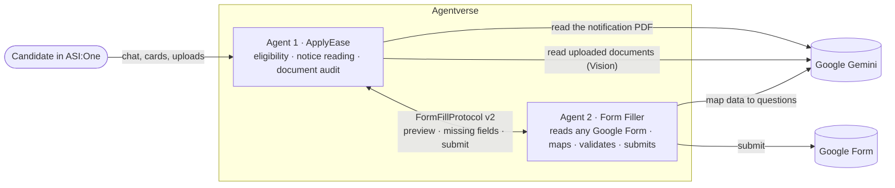

# ApplyEase — a multi-agent government-job assistant on Fetch.ai

**From "which government jobs can I apply for?" to a submitted application form, in one ASI:One chat.**

ApplyEase is two cooperating agents on Agentverse for Indian job-seekers (SSC, Railways, UPSC, police, banking and state posts). It checks your eligibility against the official notification, reads your documents with Gemini Vision, catches the mismatches that get candidates rejected at document verification, and fills the application form, asking you only for what's missing.

Built for the **Fetch.ai / ASI Alliance hackathon**: Agent Chat Protocol · ASI:One interactive cards · agent-to-agent messaging · Google Gemini.

| | |
|---|---|
| 💬 **Try it in ASI:One** | Mention **`@applyeasee`** at [asi1.ai](https://asi1.ai) and type `demo` |
| 🤖 **Agent 1 · ApplyEase** | [Agentverse profile](https://agentverse.ai/agents/details/agent1q2j5twvepd2typxmkv99u8yg83smau40px4ezr2xvel3gwds07xzzn8zawk/profile) · `agent1q2j5twvepd2typxmkv99u8yg83smau40px4ezr2xvel3gwds07xzzn8zawk` |
| ✍️ **Agent 2 · Form Filler** | [Agentverse profile](https://agentverse.ai/agents/details/agent1q2dtw0yzaf5ssvn590kgue3m8dknn8j2pmw2qzsgn0h900t9neuds3rdwe5/profile) · `agent1q2dtw0yzaf5ssvn590kgue3m8dknn8j2pmw2qzsgn0h900t9neuds3rdwe5` |
| 📄 **Demo notices & form** | [stdioa9xh/documentpdf](https://github.com/stdioa9xh/documentpdf): 8 fictional recruitment notices, card artwork and the demo Google Form |
| 🎬 **Demo video** | _link to be added_ |
| 🔗 **Shared ASI:One chat** | _link to be added_ |

---

## The problem

Millions of aspirants apply for government jobs every year and lose out in three avoidable ways:

1. **Eligibility confusion.** Age limits, category relaxations (OBC +3, SC/ST +5, PwBD +10), qualification levels and physical standards differ in every notice, and the rules are buried in long PDFs.
2. **Document rejections.** Class 10 says *Rajesh Kumar Sharma*, Aadhaar says *Rajesh K Sharma*, the OBC certificate is from last financial year. These mismatches surface only at document verification, after the candidate has cleared the exam.
3. **Form drudgery.** The same details are typed into every application form, with every typo a risk.

## How it works



| Step | What happens | Agent |
|---|---|---|
| **1 · 3-tier assessment** | From age, qualification and category: **Tier 1** posts you can apply for today (fee, last date, links), **Tier 2** the career ladder (exact qualification gap and the age you become eligible), **Tier 3** a month-by-month preparation roadmap | Agent 1 |
| **2 · Reads the official notice** | Gemini extracts the age limit and cut-off date, relaxations, qualification, closing date, required documents and the form's fields from the PDF, and **eligibility is checked against those rules** | Agent 1 + Gemini |
| **3 · Document check** | Upload a photo or PDF with **+**. Gemini Vision reads name, parents, date of birth and issue dates (only the last 4 Aadhaar digits are kept). The audit flags name mismatches (initials, missing middle name, spelling, surname change after marriage), DOB conflicts, outdated or State-format OBC-NCL / EWS certificates and missing documents, and **drafts the name affidavit** | Agent 1 + Gemini Vision |
| **4 · Fills the application** | Agent 1 asks Agent 2 to fill the post's Google Form. Agent 2 reads the form, fills what it can and **reports back what's missing**. Agent 1 turns that into a card with the form's own questions and options, then a review card, and only after you confirm does Agent 2 submit and verify Google recorded it | Agent 1 ⇄ Agent 2 |

### Why two agents

The Form Filler is a separate, reusable agent: it fills **any** public Google Form (all pages and question types) and works directly in ASI:One or for any agent that speaks `FormFillProtocol v2.0.0`. ApplyEase owns the conversation and the user's data; the Form Filler owns form understanding. When the Form Filler can't answer a question it doesn't guess. It sends a typed list (question, type, options, reason) back to ApplyEase, which asks the user. That **two-way loop between agents** is the heart of the design.

## Try it in 1 minute

In [ASI:One](https://asi1.ai):

1. `@applyeasee demo` loads the sample candidate *Aarav Sharma* (DOB 14/05/1998, B.Tech, OBC).
2. Tap **ADRB CGLE (Demo)**. Gemini reads the notice: the limit is 27, Aarav is 28, so he's **eligible through OBC +3**.
3. **Check my documents**, then upload [`demo/sample_class10_marksheet_aarav.jpg`](demo/sample_class10_marksheet_aarav.jpg) with **+** (or tap 🧪 **Use sample documents**).
4. **✍️ Fill application form (Agent 2)**. Agent 2 fills 16 of 17 questions and asks only for the Aadhaar number. Tick 🧪 *Use sample data*, then **Send**.
5. Review, then **Submit application (Agent 2)**: ✅ recorded by Google.

**With your own details:** type something like `I am 22, 12th pass, SC, female` or `DOB 14/08/2003, B.Sc, EWS`. There are **8 demo vacancies** (10th pass to post-graduate, ages 18–40, including a Constable post with height and running standards), so almost any profile gets a full-pipeline vacancy, shown alongside real SSC / RRB / UPSC / IBPS posts.

**More to try:**
- `details SSC CPO SI`: full eligibility and physical screening for one post
- `I am 18, 12th pass with PCM, married male. Can I apply for NDA?`: blocked by the unmarried rule
- `marksheet name Rajesh Kumar Sharma, aadhaar name Rajesh K Sharma, OBC certificate issued 15/01/2025`: a typed document audit
- `mera naam marksheet me Anita Kumari hai aur aadhaar me Anita Devi`: Hinglish works
- Paste any Google Form link with `Label: value` lines, and Agent 2 fills it
- `reset` / `delete my data`

## ASI:One interactive cards

Every reply carries a card (`card_protocol_version: 1`), using all five kinds:

| Card kind | Used for |
|---|---|
| `form` | Profile, typed document details, and **the questions Agent 2 couldn't answer**, generated from the real form with its options |
| `carousel` | Eligible posts with artwork, deadline and relaxation badges, plus career-ladder and document-check tiles |
| `detail` | A post (eligibility, fee, documents, actions) and the preparation roadmap |
| `review` | The name affidavit before printing; the application before submission |
| `custom` | Document checklist with status badges, audit findings, career ladder, submission receipt |

Every form card has a 🧪 **"Fill anything I leave empty with sample data"** checkbox, so anyone can test each step without real documents.

## Design choices

- **Rules decide, AI reads.** Eligibility, relaxations and audit verdicts come from deterministic rules. Gemini only *extracts* (notice facts, document fields, form mapping), and every extracted value is validated, so a model error can't invent a post, a date or a relaxation.
- **One reply per message.** ASI:One shows one reply per user message, so Agent 1 answers in the same turn, except form filling, where it replies once Agent 2 answers (measured round trips 5–33 s; 90 s timeout).
- **Resilient.** Gemini model fallback on quota limits or timeouts, large photos downscaled before upload, notice reading falls back to the notice's structured copy, and live vacancy data (Supabase) falls back to a curated list.
- **Private.** Uploaded files are read once and never stored; only names and dates are kept, and `reset` deletes them. The full Aadhaar number is never shown in chat or links, and form answers are dropped after submission. The agents download files only from Fetch.ai hosts.

## Repository

```
agentverse_agent.py              Agent 1 · ApplyEase (Agent Chat Protocol + FormFill client)
form_filler_agent.py             Agent 2 · Form Filler (FormFillProtocol v2.0.0 + Agent Chat Protocol)
agentverse/applyease_profile.md  Agent 1's Agentverse profile text (what ASI:One reads to find it)
agentverse/form_filler_profile.md
tests/agentverse_test_suite.csv  Questions + expected answers for Agentverse's test suite
demo/                            Sample Class 10 marksheet for the demo
```

## Deploy

Each agent is a single file using only the Python standard library plus `uagents`, so both run as **hosted agents on Agentverse**.

| | Agent 1 · ApplyEase | Agent 2 · Form Filler |
|---|---|---|
| Code | `agentverse_agent.py` | `form_filler_agent.py` |
| Secrets | `GEMINI_API_KEY` · optional `SUPABASE_URL` + `SUPABASE_ANON_KEY` (live vacancies), `AGENT_2_ADDRESS` | `GEMINI_API_KEY` |
| Optional | `GEMINI_MODEL` (default `gemini-3.5-flash-lite`), `GEMINI_FALLBACK_MODELS` | same |
| Profile text | `agentverse/applyease_profile.md` | `agentverse/form_filler_profile.md` |

1. Create two hosted agents on [Agentverse](https://agentverse.ai), paste one file into each and add the secrets.
2. If your Form Filler has a different address, set `AGENT_2_ADDRESS` on Agent 1.
3. Both files share the `FormFillRequest` / `FormFillResponse` classes, and uagents routes messages by schema digest, so **change them in both files together**.

## Hackathon requirements

| Requirement | Where |
|---|---|
| Registered on Agentverse | Both agents are hosted on Agentverse (addresses above) |
| Agent Chat Protocol | `chat_protocol_spec` in both agents: `ChatMessage`, `ChatAcknowledgement`, `TextContent`, `MetadataContent`, `ResourceContent` for uploads |
| Discoverable in ASI:One | `@applyeasee`, with profile text in `agentverse/applyease_profile.md` |
| Tool use and multi-step reasoning | Notice extraction → rule-based eligibility → document reading → audit → form filling |
| **Bonus:** ASI interactive cards | All five kinds: `form`, `carousel`, `detail`, `review`, `custom` |
| **Bonus:** multi-agent orchestration | Agent 1 ⇄ Agent 2 over `FormFillProtocol v2.0.0`, with missing-field round trips |

## Limits

- **Guidance, not a final verdict:** confirm dates, relaxations and physical standards in the official notification before applying or paying a fee.
- The **demo vacancies are fictional** (the "ApplyEase Demo Recruitment Board"); use only dummy data in the demo form.
- Forms that require Google sign-in or a file upload can't be filled automatically; Agent 2 says so and gives the link.
- State OBC lists differ from the central list; if your caste is OBC only in your state's list, central jobs treat you as UR.
